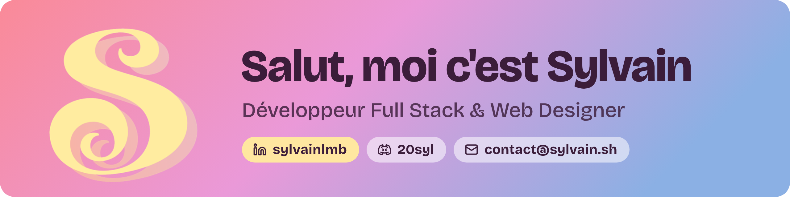
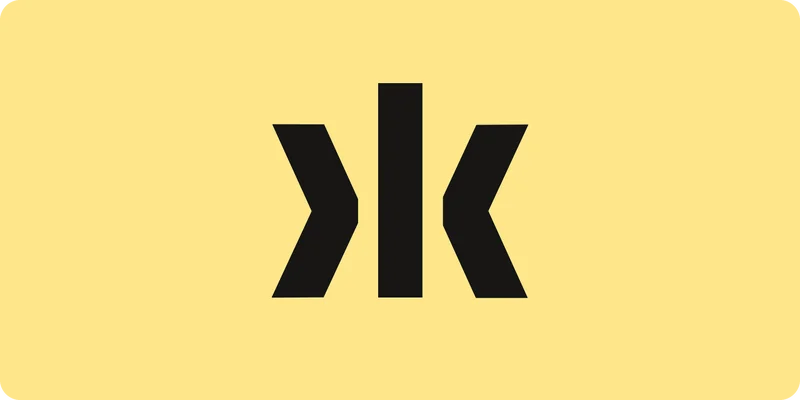
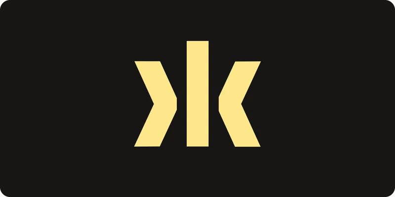
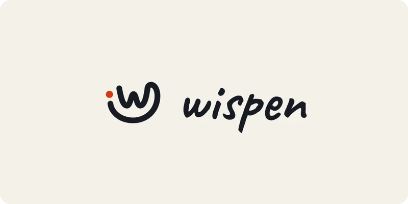
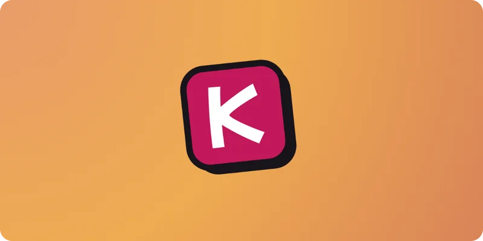
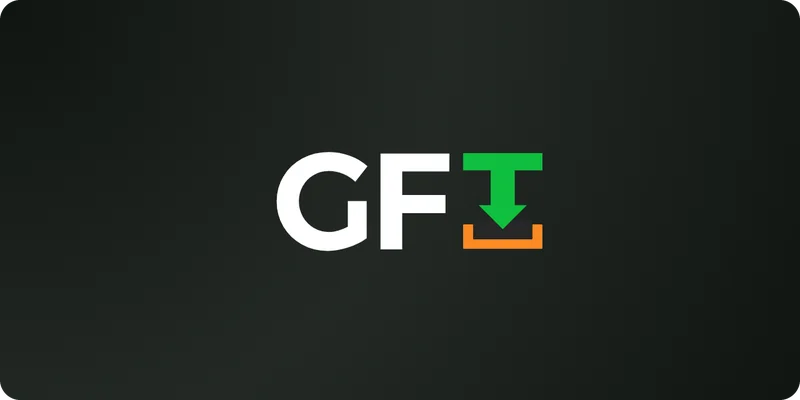
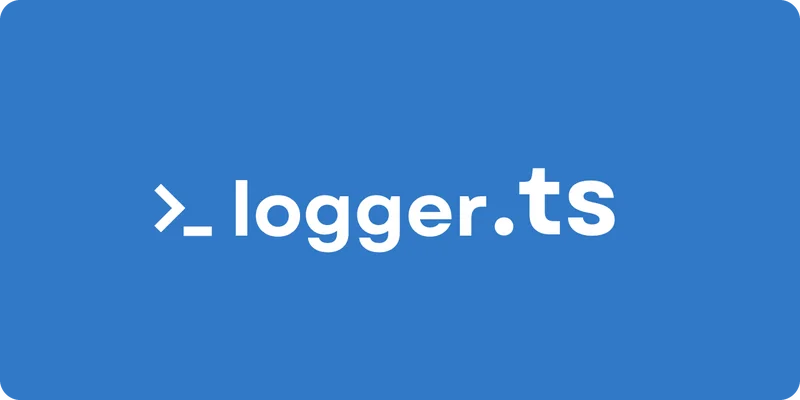
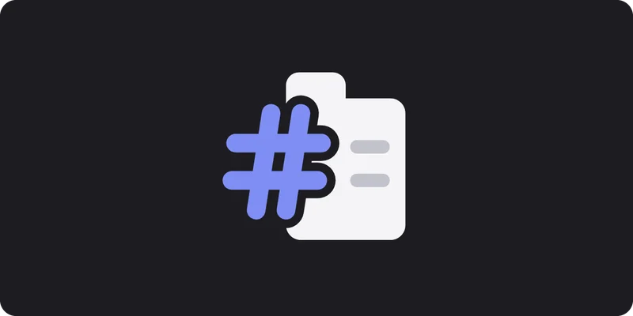
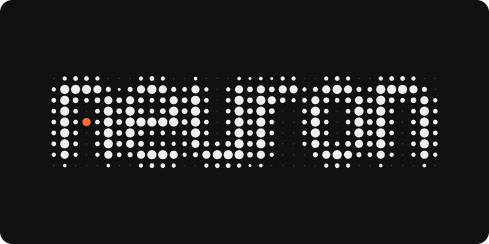
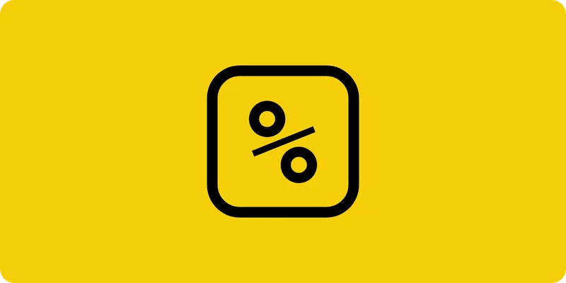

    Je conçois des sites web modernes, des APIs robustes et des outils de gestion serveur. 
    Apprenez-en plus en vous rendant <a href="https://sylvain.sh">ici</a> !

    
    
    
    
    

## 🛠️ Technologies

    <a href="https://www.typescriptlang.org"><picture><source media="(prefers-color-scheme: dark)" srcset="https://skillicons.dev/icons?i=ts&theme=dark"/></picture></a>
    <a href="https://developer.mozilla.org/docs/Web/JavaScript"><picture><source media="(prefers-color-scheme: dark)" srcset="https://skillicons.dev/icons?i=js&theme=dark"/></picture></a>
    <a href="https://developer.mozilla.org/docs/Web/HTML"><picture><source media="(prefers-color-scheme: dark)" srcset="https://skillicons.dev/icons?i=html&theme=dark"/></picture></a>
    <a href="https://developer.mozilla.org/docs/Web/CSS"><picture><source media="(prefers-color-scheme: dark)" srcset="https://skillicons.dev/icons?i=css&theme=dark"/></picture></a>
    <a href="https://go.dev"><picture><source media="(prefers-color-scheme: dark)" srcset="https://skillicons.dev/icons?i=go&theme=dark"/></picture></a>
    <a href="https://www.python.org"><picture><source media="(prefers-color-scheme: dark)" srcset="https://skillicons.dev/icons?i=py&theme=dark"/></picture></a>
    <a href="https://www.php.net"><picture><source media="(prefers-color-scheme: dark)" srcset="https://skillicons.dev/icons?i=php&theme=dark"/></picture></a>
    <a href="https://www.gnu.org/software/bash"><picture><source media="(prefers-color-scheme: dark)" srcset="https://skillicons.dev/icons?i=bash&theme=dark"/></picture></a>
    <a href="https://en.cppreference.com/w/c"><picture><source media="(prefers-color-scheme: dark)" srcset="https://skillicons.dev/icons?i=c&theme=dark"/></picture></a>
    <a href="https://isocpp.org"><picture><source media="(prefers-color-scheme: dark)" srcset="https://skillicons.dev/icons?i=cpp&theme=dark"/></picture></a>
    <a href="https://www.java.com"><picture><source media="(prefers-color-scheme: dark)" srcset="https://skillicons.dev/icons?i=java&theme=dark"/></picture></a>
    <a href="https://www.rust-lang.org"><picture><source media="(prefers-color-scheme: dark)" srcset="https://skillicons.dev/icons?i=rust&theme=dark"/></picture></a>
     
    <a href="https://react.dev"><picture><source media="(prefers-color-scheme: dark)" srcset="https://skillicons.dev/icons?i=react&theme=dark"/></picture></a>
    <a href="https://nextjs.org"><picture><source media="(prefers-color-scheme: dark)" srcset="https://skillicons.dev/icons?i=nextjs&theme=dark"/></picture></a>
    <a href="https://nodejs.org"><picture><source media="(prefers-color-scheme: dark)" srcset="https://skillicons.dev/icons?i=nodejs&theme=dark"/></picture></a>
    <a href="https://expressjs.com"><picture><source media="(prefers-color-scheme: dark)" srcset="https://skillicons.dev/icons?i=express&theme=dark"/></picture></a>
    <a href="https://tailwindcss.com"><picture><source media="(prefers-color-scheme: dark)" srcset="https://skillicons.dev/icons?i=tailwind&theme=dark"/></picture></a>
    <a href="https://vuejs.org"><picture><source media="(prefers-color-scheme: dark)" srcset="https://skillicons.dev/icons?i=vue&theme=dark"/></picture></a>
    <a href="https://vitejs.dev"><picture><source media="(prefers-color-scheme: dark)" srcset="https://skillicons.dev/icons?i=vite&theme=dark"/></picture></a>
    <a href="https://vuetifyjs.com"><picture><source media="(prefers-color-scheme: dark)" srcset="https://skillicons.dev/icons?i=vuetify&theme=dark"/></picture></a>
    <a href="https://flutter.dev"><picture><source media="(prefers-color-scheme: dark)" srcset="https://skillicons.dev/icons?i=flutter&theme=dark"/></picture></a>
     
    <a href="https://www.docker.com"><picture><source media="(prefers-color-scheme: dark)" srcset="https://skillicons.dev/icons?i=docker&theme=dark"/></picture></a>
    <a href="https://nginx.org"><picture><source media="(prefers-color-scheme: dark)" srcset="https://skillicons.dev/icons?i=nginx&theme=dark"/></picture></a>
    <a href="https://www.kernel.org"><picture><source media="(prefers-color-scheme: dark)" srcset="https://skillicons.dev/icons?i=linux&theme=dark"/></picture></a>
    <a href="https://git-scm.com"><picture><source media="(prefers-color-scheme: dark)" srcset="https://skillicons.dev/icons?i=git&theme=dark"/></picture></a>
    <a href="https://github.com"><picture><source media="(prefers-color-scheme: dark)" srcset="https://skillicons.dev/icons?i=github&theme=dark"/></picture></a>
    <a href="https://www.elastic.co/elasticsearch"><picture><source media="(prefers-color-scheme: dark)" srcset="https://skillicons.dev/icons?i=elasticsearch&theme=dark"/></picture></a>
    <a href="https://www.postgresql.org"><picture><source media="(prefers-color-scheme: dark)" srcset="https://skillicons.dev/icons?i=postgres&theme=dark"/></picture></a>
    <a href="https://www.mysql.com"><picture><source media="(prefers-color-scheme: dark)" srcset="https://skillicons.dev/icons?i=mysql&theme=dark"/></picture></a>
    <a href="https://www.mongodb.com"><picture><source media="(prefers-color-scheme: dark)" srcset="https://skillicons.dev/icons?i=mongodb&theme=dark"/></picture></a>
    <a href="https://www.figma.com"><picture><source media="(prefers-color-scheme: dark)" srcset="https://skillicons.dev/icons?i=figma&theme=dark"/></picture></a>
    <a href="https://www.blender.org"><picture><source media="(prefers-color-scheme: dark)" srcset="https://skillicons.dev/icons?i=blender&theme=dark"/></picture></a>
    <a href="https://code.visualstudio.com"><picture><source media="(prefers-color-scheme: dark)" srcset="https://skillicons.dev/icons?i=vscode&theme=dark"/></picture></a>
     
    

## 🔧 Mes principaux projets

### Moxon

<table>
    <tr>
        <td width="50%" valign="top">
             
            <b>Moxon</b> 
            Node.js · Express · TypeScript 
            Package npm de plus de 40 modules, ou une API REST complète à héberger en une commande. 
            <a href="https://sylvain.sh/projet/moxon">Découvrir</a> · <a href="https://api.moxon.dev">api.moxon.dev</a> · <a href="https://npmjs.com/package/@moxon/api">npm</a>
        </td>
        <td width="50%" valign="top">
             
            <b>Moxon Docs</b> 
            Next.js · TypeScript · Tailwind CSS 
            Documentation interactive : Try et Playground branchés sur l'API, recherche au clavier, v1 à v6 en FR/EN. 
            <a href="https://sylvain.sh/projet/docs">Découvrir</a> · <a href="https://moxon.dev">moxon.dev</a>
        </td>
    </tr>
</table>

### Nouveautés

<table>
    <tr>
        <td width="33%" valign="top">
             
            <b>tote</b>  
            Go · Bubble Tea 
            Lanceur en terminal pour SSH, dépôts, alias et fonctions. Le successeur de MN. 
            <a href="https://sylvain.sh/projet/tote">Découvrir</a> · <a href="https://github.com/totecli/tote">GitHub</a>
        </td>
        <td width="33%" valign="top">
             
            <b>Wispen</b>  
            Next.js · PWA 
            Tableau blanc open source, sans compte, entièrement dans le navigateur. 
            <a href="https://sylvain.sh/projet/wispen">Découvrir</a> · <a href="https://wispen.sylvain.sh">wispen.sylvain.sh</a>
        </td>
        <td width="33%" valign="top">
             
            <b>Kao</b>  
            Next.js · Ruffle 
            Éditeur d'avatars manga dans le navigateur, avec export HD sans perte. 
            <a href="https://sylvain.sh/projet/kao">Découvrir</a> · <a href="https://kao.sylvain.sh">kao.sylvain.sh</a>
        </td>
    </tr>
</table>

### Outils

<table>
    <tr>
        <td width="33%" valign="top">
             
            <b>Dropr</b>  
            Node.js · TypeScript · CLI · 4.5.0 
            Serveur de CDN versionné, en ligne de commande et en bibliothèque. 
            <a href="https://sylvain.sh/projet/dropr">Découvrir</a> · <a href="https://dropr.sylvain.sh">dropr.sylvain.sh</a> · <a href="https://www.npmjs.com/package/dropr">npm</a>
        </td>
        <td width="33%" valign="top">
             
            <b>GFT</b>  
            Bash · CLI · 1.1.0 
            Infos de releases GitHub et téléchargement d'assets, sans authentification. 
            <a href="https://sylvain.sh/projet/gft">Découvrir</a> · <a href="https://github.com/20syldev/gft">GitHub</a>
        </td>
        <td width="33%" valign="top">
             
            <b>Logger.ts</b> 
            Node.js · TypeScript 
            Logs structurés en JSON, avec thèmes, groupes et API HTTP intégrée. 
            <a href="https://sylvain.sh/projet/logger">Découvrir</a> · <a href="https://www.npmjs.com/package/@20syldev/logger.ts">npm</a>
        </td>
    </tr>
</table>

### Web

<table>
    <tr>
        <td width="33%" valign="top">
             
            <b>Peek</b> 
            Next.js · Markdown 
            Affiche n'importe quel README comme GitHub, GitLab, Obsidian ou CommonMark. 
            <a href="https://sylvain.sh/projet/peek">Découvrir</a> · <a href="https://peek.sylvain.sh">peek.sylvain.sh</a>
        </td>
        <td width="33%" valign="top">
             
            <b>Neuron</b> 
            Next.js · Réseaux de neurones 
            Essai interactif sur les réseaux de neurones, de l'encre au sens, sans serveur. 
            <a href="https://sylvain.sh/projet/neuron">Découvrir</a> · <a href="https://neuron.sylvain.sh">neuron.sylvain.sh</a>
        </td>
        <td width="33%" valign="top">
             
            <b>strftime</b> 
            Next.js · Date &amp; Time 
            Constructeur de formats de date, avec linter de portabilité C / Python / Ruby. 
            <a href="https://sylvain.sh/projet/strftime">Découvrir</a> · <a href="https://strftime.sylvain.sh">strftime.sylvain.sh</a>
        </td>
    </tr>
</table>

### Pour ZENETYS

<table>
    <tr>
        <td width="25%" valign="top">
            <a href="https://sylvain.sh/projet/hyoai"><b>HYOAI</b></a> 
            Next.js · TypeScript · LLM 
            Chat 100 % navigateur pour tout LLM compatible OpenAI. 
            <a href="https://sylvain.sh/projet/hyoai">Découvrir</a> · <a href="https://tools.zenetys.com/hyoai/">Essayer</a>
        </td>
        <td width="25%" valign="top">
            <a href="https://sylvain.sh/projet/zpki"><b>ZPKI</b></a> 
            Node.js · Bash · OpenSSL 
            Gestionnaire de certificats X.509 adossé à OpenSSL. 
            <a href="https://sylvain.sh/projet/zpki">Découvrir</a> · <a href="https://tools.zenetys.com/zpki/">Essayer</a>
        </td>
        <td width="25%" valign="top">
            <a href="https://sylvain.sh/projet/ztable"><b>Ztable</b></a> 
            Vue.js · Vuetify · JSON 
            Visionneuse JSON sans serveur et composant de tableau Vue. 
            <a href="https://sylvain.sh/projet/ztable">Découvrir</a> · <a href="https://www.npmjs.com/package/@zenetys/ztable">npm</a>
        </td>
        <td width="25%" valign="top">
            <a href="https://sylvain.sh/projet/zeportal"><b>Zenetys Tools</b></a> 
            Next.js · TypeScript · Hub 
            Le portail qui regroupe les outils et démos web de ZENETYS. 
            <a href="https://sylvain.sh/projet/zeportal">Découvrir</a> · <a href="https://tools.zenetys.com">tools.zenetys.com</a>
        </td>
    </tr>
</table>

---

    <a href="https://github.com/20syldev">
        <picture>
            <source media="(prefers-color-scheme: dark)" srcset="https://github-readme-streak-stats.herokuapp.com?user=20syldev&theme=dark&border_radius=20&locale=fr&date_format=j%20M%5B%20Y%5D&card_width=1000&card_height=250"/>
            
        </picture>
    </a>
     
    

