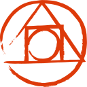
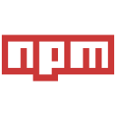
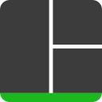

# 👋 Salut, moi c'est Sylvain !

### Un développeur Web Full-Stack et Web Designer.

Je conçois des sites web modernes, des APIs robustes et des outils de gestion serveur.
Apprenez-en plus en vous rendant [ici](https://sylvain.pro) !

## 🛠️ Technologies

    
    
    
    
    
    
    
    
    
    
    
    
    
    
    
    
    
    
    
    
    

    
    
    
    
    
    
    
    
    
    
    
    
    
    
    

    
    
    
    
    

    
    
    
    
    
    
    
    

    
    
    
    
    
    
    
    
    
    
    

    
    
    
    

---

## 🔧 Mes principaux projets

### Portfolio (HTML, CSS, JS)
Site web personnel, vitrine de mes projets, compétences et expériences.
Design moderne, animations, mode clair/sombre, navigation intuitive et responsive.
[Découvrir mon portfolio](https://sylvain.pro/projet/portfolio) | [sylvain.pro](https://sylvain.pro) | [sylv.pro](https://sylv.pro)

---

### API (Node.js, Express)
API Node.js Express, hébergée 24/7, pensée pour les développeurs et utilisateurs.
Elle propose des outils dynamiques, une architecture REST simple à intégrer, et une documentation claire ([docs.sylvain.pro](https://docs.sylvain.pro)).
Quota gratuit, extensible.
[Découvrir l'API](https://sylvain.pro/projet/api) | [api.sylvain.pro](https://api.sylvain.pro)

---

### Docs (HTML, CSS, JS)
Documentation interactive et moderne pour mon API.
Explications détaillées, exemples, présentation claire, sections dédiées à chaque service.
[Découvrir la documentation](https://sylvain.pro/projet/docs) | [docs.sylvain.pro](https://docs.sylvain.pro)

---

### Dashboard V2 (Node.js, HTML, CSS, JS)
Rework complet de l'interface de monitoring anciennement sur Kibana, avec de nouvelles fonctionnalités.
Interface modernisée, plus intuitive et améliorée.
[Découvrir Dashboard V2](https://sylvain.pro/alternance#monitoring)

---

### Lyah (Node.js, WebSocket, HTML, CSS, JS)
Application web de chat collaboratif, conçue pour faciliter la communication en équipe et l'intégration d'IA.
Interface moderne, intuitive et responsive.
[Découvrir Lyah](https://sylvain.pro/alternance#lyah)

---

### LeBonChar (SQL, PHP, HTML, CSS, JS)
Outil pour explorer, rechercher et copier rapidement des caractères Unicode et spéciaux.
Interface simple, efficace, utile pour développeurs et designers.
[Découvrir LeBonChar](https://sylvain.pro/projet/lebonchar) | [lebonchar.site](https://lebonchar.site)

---

    
    
    

